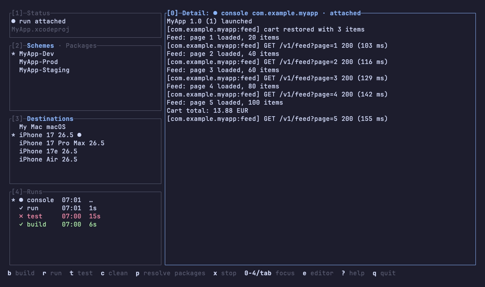
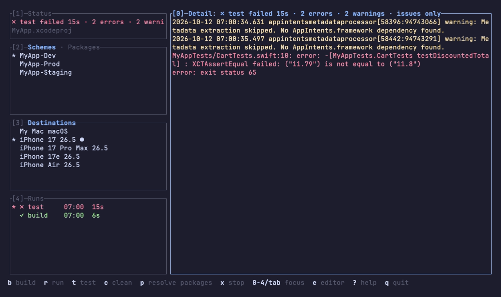
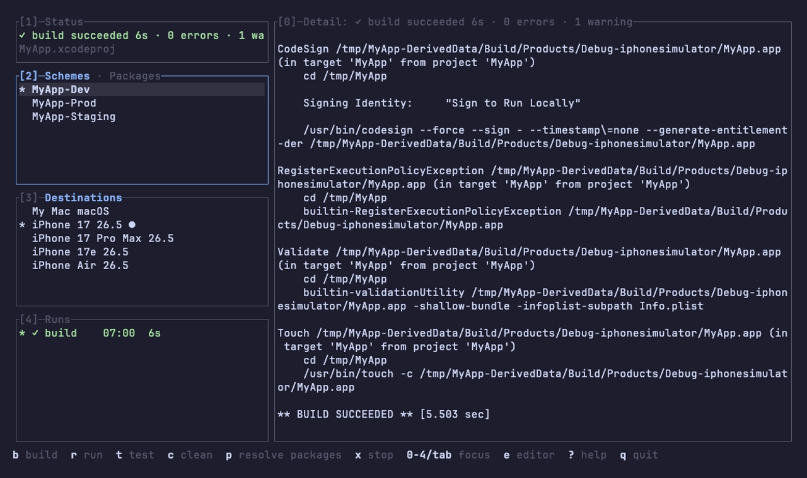

# xctui

A TUI wrapper for xcodebuild.

Why?

* Less time in Xcode (which is a blessing),
* no need to remember xcodebuild commands,
* quicker builds/runs/tests outside agents,
* less time in Xcode (can't stress this enough).

## Install

Needs macOS with Xcode.

### Go

    go install github.com/libec/xctui@latest

### Homebrew

    brew install libec/tap/xctui

### Build it yourself

xctui also exists without code. (A [software library with no code](https://www.dbreunig.com/2026/01/08/a-software-library-with-no-code.html) makes sense, a TUI app maybe less so, but I wanted to do it anyway.)
The `spec/` folder defines behavior, tests, UX, and such without any application code. Feed it to agents and `build. no mistakes`. You can do it in Rust, feed it to Haiku, and maintain it yourself.

## Usage

Run `xctui` in the folder with your `.xcworkspace` or `.xcodeproj`.
Pick a scheme and a destination (space or enter), then press `b` to build, `t` to test, `r` to run on the destination, and `x` to stop.
A run attaches the app's console: its `print` output and its `os_log` messages, the way Xcode shows them.

Every build, test, and run lands in Runs with its log, and the history is kept between sessions.
`i` shows only errors and warnings, `/` filters, `e` opens the log in `$EDITOR`, and `?` lists every key.

## Screenshots

A failing test, filtered to its issues:

A finished build:

